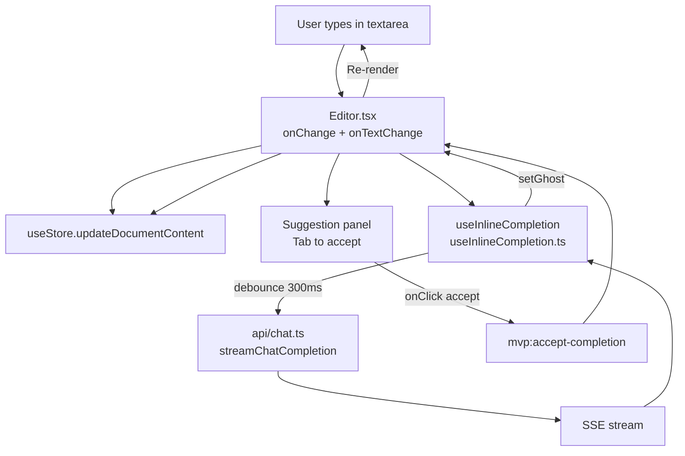
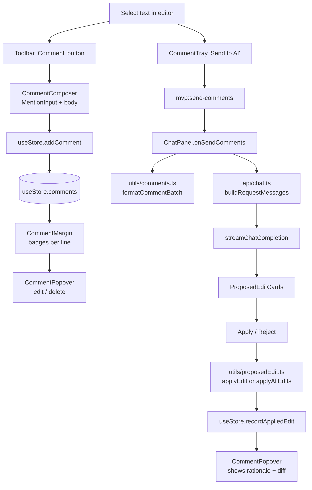

# ApEditor — Architecture Map

> A navigation guide for the codebase. Skim this first, then jump to file:line as needed.

**Repo:** ApEditor (a local-first AI markdown editor).
**Stack:** React 18 + TypeScript + Vite + Zustand (with `persist`) + react-markdown + Tailwind + pdfjs-dist + PaddleOCR.
**Top-level shape:** 43 source files, ~17.6k LoC, 3 mega-files (Editor, ChatPanel, useStore), 1 1.9k-line CSS file, one persisted Zustand store.

---

## 1. Top-level composition

```
src/main.tsx
  └─ <App />                       src/App.tsx (335)
       ├─ Topbar (local)           335
       ├─ <Sidebar />              components/Sidebar.tsx (156)
       ├─ <Editor />               components/Editor.tsx (1801)  ← biggest
       ├─ <ChatPanel />            components/ChatPanel.tsx (1287) ← 2nd biggest
       ├─ <EdgeAnchor /> × 3       components/EdgeAnchor.tsx (70)
       └─ Overlays (always mounted, hidden when closed)
           ├─ <SettingsModal />
           ├─ <PromptLibrary />
           ├─ <RevisionHistory />
           └─ <HelpDocs />
```

All top-level state lives in `useStore` (the Zustand store). Most children consume it via selectors. Cross-component coordination (editor → chat, comment send, etc.) is via `window` custom events — see §6.

---

## 2. Data flow: "user types → AI completion → user accepts"



Key files:
- `src/components/Editor.tsx:1493-1540` — textarea + `onChange` + caret reporting
- `src/hooks/useInlineCompletion.ts:240-340` — debounce, suppression gates, ghost lifecycle
- `src/api/chat.ts:73-148` — `streamChatCompletion` SSE loop
- `src/api/chat.ts:171-410` — `buildRequestMessages` (system + doc outline + mentions)
- `src/hooks/useInlineCompletion.ts:362-465` — duplicate SSE loop (intentionally kept inline per the plan)

---

## 3. Data flow: "comment → batch send → AI reply → apply"



Key files:
- `src/components/Editor.tsx:750-810` — `openComposer` / `handleSaveComment`
- `src/components/Editor.tsx:845-880` — `handleSendToAi` (dispatches the event)
- `src/components/ChatPanel.tsx:130-260` — `onSendComments` listener + streaming
- `src/utils/comments.ts:228-290` — `formatCommentBatch` (the `[c1]` / `Before:` / `After:` block format)
- `src/api/chat.ts:259-310` — `looksLikeCommentBatch` (matches the format above; keep them in sync)
- `src/utils/proposedEdit.ts:339-360` — `applyEdit`; `:362-415` — `applyAllEdits`
- `src/store/useStore.ts:746-885` — `recordAppliedEdit` (re-anchors the comment to the adopted text)

---

## 4. Module index

### `src/api/` (1 file, 1065 LoC)

| File | Purpose | Public API |
|---|---|---|
| [`api/chat.ts`](api/chat.ts) | OpenAI-compatible chat client + prompt builder | `streamChatCompletion`, `buildRequestMessages`, `ApiError`, `DEFAULT_SYSTEM_MESSAGE`, `PROPOSED_EDIT_RULES_DEFAULT`, `resolveChatEndpoint`, `assertSafeChatEndpoint`, `normalize*`, `isStale*`, `isCurrent*` |

### `src/components/` (16 files, 7391 LoC)

| File | LoC | Purpose |
|---|---|---|
| [`Editor.tsx`](components/Editor.tsx) | 1801 | The core editor: textarea + preview + comment composer + suggestion panel + comment tray. Mixes too many concerns — see REFACTORING.md. |
| [`ChatPanel.tsx`](components/ChatPanel.tsx) | 1287 | AI chat + keyless fallback (Google AI Mode) + proposed-edit cards + Apply-All + rejection staging. Largest "feature" component. |
| [`SettingsModal.tsx`](components/SettingsModal.tsx) | 822 | API provider, key, model, system message, rationale rules, font sizes. Resizable from 8 edges. |
| [`CommentPopover.tsx`](components/CommentPopover.tsx) | 883 | Read/edit/delete one comment. Shows diffs of applied proposed edits. Resizable. |
| [`ProposedEditCard.tsx`](components/ProposedEditCard.tsx) | 747 | One AI-proposed edit: original ↔ replacement diff, Apply / Reject / Force-apply. Resizable from 8 edges. |
| [`RevisionHistory.tsx`](components/RevisionHistory.tsx) | 232 | List + diff + restore + delete saved revisions. |
| [`CommentComposer.tsx`](components/CommentComposer.tsx) | 246 | Floating composer for a new comment. Wraps `MentionInput`. |
| [`CommentLayer.tsx`](components/CommentLayer.tsx) | 155 | Mirror overlay that paints `<mark>` highlights behind the textarea. Forwards ref to `getSelectionRect`. |
| [`FileActionsButton.tsx`](components/FileActionsButton.tsx) (formerly `ImportMediaButton.tsx`) | — | Pick image/PDF → OCR (PaddleOCR) or text extract (pdfjs) → re-format via LLM, OR download the current document as Markdown. Dynamic-imports heavy deps. |
| [`PromptLibrary.tsx`](components/PromptLibrary.tsx) | 174 | Saved prompt CRUD + `{{selection}}` placeholder. |
| [`HelpDocs.tsx`](components/HelpDocs.tsx) | 185 | In-app viewer for the 14 pages under `docs/`. Theme follows the app. |
| [`Sidebar.tsx`](components/Sidebar.tsx) | 156 | Document list, rename inline, delete with confirm. |
| [`EdgeAnchor.tsx`](components/EdgeAnchor.tsx) | 70 | Edge-pinned chevron that reveals a collapsed panel. |
| [`CommentMargin.tsx`](components/CommentMargin.tsx) | 110 | Numbered badges (one per comment) in the right margin column. |
| [`CommentTray.tsx`](components/CommentTray.tsx) | 54 | Sticky "Send N comments" bar at the bottom of the editor. |
| [`ResizeHandle.tsx`](components/ResizeHandle.tsx) | 121 | Visual + pointer handler for one of 8 resize edges/corners. |

### `src/components/mentions/` (5 files, 1834 LoC)

| File | LoC | Purpose |
|---|---|---|
| [`MentionInput.tsx`](components/mentions/MentionInput.tsx) | 1039 | @-aware textarea replacement. Owns plain-text + sentinels + chip overlay. |
| [`parseMentions.ts`](components/mentions/parseMentions.ts) | 383 | Pure helpers: `parseRawWithMentions`, `serializeRawWithMentions`, `summarizeMention`, plain-text diff. Single source of truth for the sentinel format. |
| [`SectionPicker.tsx`](components/mentions/SectionPicker.tsx) | 218 | Second-stage @ picker: heading-grouped checkboxes. |
| [`DocPicker.tsx`](components/mentions/DocPicker.tsx) | 111 | First-stage @ picker: document list with fuzzy filter. Excludes current doc. |
| [`MentionChip.tsx`](components/mentions/MentionChip.tsx) | 83 | Pill UI: doc title + section summary + delete / edit sections. |

### `src/config/` (1 file, 117 LoC)

| File | Purpose |
|---|---|
| [`config/providers.tsx`](config/providers.tsx) | Per-provider preset (`PROVIDERS[]`): endpoint, model presets, default model, help text, key placeholder. Exports `getProvider`, `requiresApiKey`. |

### `src/docs/` (1 file, 93 LoC)

| File | Purpose |
|---|---|
| [`docs/catalog.ts`](docs/catalog.ts) | Help page catalog. Loads `docs/*.md` via `import.meta.glob(..., { query: '?raw' })` so editing a docs file updates the in-app Help on next build. |

### `src/hooks/` (3 files, 1245 LoC)

| File | LoC | Purpose |
|---|---|---|
| [`useInlineCompletion.ts`](hooks/useInlineCompletion.ts) | 566 | The 300ms-debounced one-sentence inline-completion state machine. Owns ghost + streaming + cancel + Tab/Esc + manual trigger. |
| [`useDocumentMentions.ts`](hooks/useDocumentMentions.ts) | 459 | Heading-grouped sections + paragraph previews for the @ picker. Same paragraph boundary algorithm as `buildDocOutline` in `api/chat.ts`. |
| [`useDragResize.ts`](hooks/useDragResize.ts) | 220 | Pointer-event based drag hook. Returns a stable `start(handle, e)` callback. Used by every resizable panel / card / handle. Exports bounds constants used across the app. |

### `src/store/` (1 file, 1364 LoC) — see §5

| File | Purpose |
|---|---|
| [`store/useStore.ts`](store/useStore.ts) | The single Zustand store. Persisted to `localStorage` under `ai-text-editor-mvp`. Exports the `useStore` hook and `useCurrentDocument()`. |

### `src/utils/` (9 files, 1884 LoC)

| File | LoC | Purpose |
|---|---|---|
| [`comments.ts`](utils/comments.ts) | 566 | Pure: `reanchorComment`, `reanchorAll`, `formatCommentBatch`, `getSelectionRect`, `clampToContainer`, `clampCommentBody`. Zero React. |
| [`proposedEdit.ts`](utils/proposedEdit.ts) | 521 | Pure: `parseProposedEdits`, `findEditAnchor` (6 fallback strategies), `applyEdit`, `applyAllEdits`, `applyEditAtCaret`, `formatRejectionBatch`, `cleanCommentForPrompt`. |
| [`ocr.ts`](utils/ocr.ts) | 323 | Browser-side OCR via PaddleOCR. Dynamic-imported. |
| [`googleAiMode.ts`](utils/googleAiMode.ts) | 174 | Build a Google AI Mode deep-link URL from a chat payload. |
| [`ocrMarkdown.ts`](utils/ocrMarkdown.ts) | 97 | Turn raw OCR text into reader-friendly Markdown via a small chat-completion call. |
| [`pdf.ts`](utils/pdf.ts) | 91 | Thin pdfjs-dist wrapper: text extraction + canvas rasterization. |
| [`diff.ts`](utils/diff.ts) | 77 | `lineDiff` + `splitDiff` for the revision history + ProposedEditCard previews. |
| [`theme.ts`](utils/theme.ts) | 12 | `applyThemeClass(theme)`. Single source of truth for `<html class="dark">`. |
| [`markdown.ts`](utils/markdown.ts) | 23 | Shared `remarkPlugins` + `rehypePlugins` (raw + sanitize with `<u>` allowed). |

### `src/` (root)

| File | LoC | Purpose |
|---|---|---|
| [`App.tsx`](App.tsx) | 335 | Composition + global hotkeys (Cmd+. , Cmd+, Cmd+h, Cmd+/, Cmd+b, Cmd+Shift+c) + theme/font-size sync + first-run onboarding pop. |
| [`main.tsx`](main.tsx) | 31 | Pre-paint theme apply + ReactDOM render. |
| [`index.css`](index.css) | 1893 | Tailwind layers + custom utility classes (`.btn-fire`, `.cm-mirror`, `.cm-tray`, etc.) + light/dark theme tokens. |
| [`types.ts`](types.ts) | 330 | All shared types: `ChatMessage`, `DocumentRecord`, `Revision`, `Prompt`, `ProposedEdit`, `ApiConfig`, `Comment`, `CommentRound`, `CommentOp`, `MentionToken`, `MentionKind`, `MentionReason`. |

---

## 5. The data spine — `useStore.ts`

This is the only state container. Single source of truth for everything except: the editor's textarea caret, the inline-completion ghost (local to the hook), and per-card UI (size, view mode, status).

### State slices

| Slice | Keyed by | Persisted? | Notes |
|---|---|---|---|
| `documents`, `currentDocumentId` | — | yes | The doc list + active doc |
| `chats` | `documentId` | yes | Per-doc chat history |
| `revisions` | `documentId` | yes | Per-doc saved snapshots |
| `prompts` | — | yes | User-saved prompt library |
| `viewMode` | — | yes | `'write' \| 'preview' \| 'split'` |
| `editorFontSize`, `uiFontSize` | — | yes | 10–24px and 12–20px, both clamped |
| `chatOpen`, `sidebarCollapsed`, `chatCollapsed`, `topbarCollapsed` | — | yes | Two flags for chat (intentional — see `useStore.ts:140-160` comment) |
| `includeSelection`, `debugMode` | — | yes | Toggles |
| `theme` | — | yes | `'light' \| 'dark'` |
| `api` | — | yes | `ApiConfig` — provider, key, endpoint, model, system message, rationale override |
| `layout` | — | yes | `sidebarWidth`, `chatWidth`, `editorSplitPct`, `previewSizes` map |
| `editorFocus` | `documentId` | **no** | `{ focused, selectionStart, selectionEnd }` per doc — populated by `Editor.tsx` on every focus/select/keyup |
| `comments` | `documentId` | yes | One `Comment[]` per doc; each `Comment` has its own `rounds[]` history |
| `commentUndoStack` | — | **no** | `CommentOp[]`, capped at `COMMENT_UNDO_STACK_LIMIT` (20) |

### Action surface (all actions go through the same pattern: never mutate, always `set(...)`)

| Group | Actions |
|---|---|
| Documents | `createDocument`, `renameDocument`, `deleteDocument`, `setCurrentDocument`, `updateDocumentContent` |
| Revisions | `saveRevision`, `deleteRevision`, `restoreRevision` |
| Chats | `appendMessage`, `updateLastAssistant`, `clearChat` |
| Prompts | `addPrompt`, `updatePrompt`, `deletePrompt` |
| View / UI | `setViewMode`, `bumpEditorFontSize`, `setUiFontSize`, `setChatOpen`, `setSidebarCollapsed`, `setChatCollapsed`, `setTopbarCollapsed`, `setIncludeSelection`, `setDebugMode`, `toggleTheme` |
| API | `setApi`, `setLayout`, `setPreviewSize`, `setEditorFocus` |
| Comments | `addComment`, `updateCommentBody`, `appendCommentRound`, `recordAppliedEdit`, `markCommentsSent`, `deleteComment`, `replaceCommentsForDocument`, `undoLastCommentOp` |

### Migration logic (rehydrate-time)

`useStore.ts:1023-1170` runs on every load. Notable:

- **API provider coercion** — unknown providers reset to `'minimax'`.
- **Layout bounds clamping** — stale sidebar/chat widths + `editorSplitPct` are clamped to current bounds.
- **Comment shape migration** — pre-`rounds` comments are wrapped in a single `CommentRound` from the flat fields.
- **Stale system message / rationale override detection** — older built-in defaults normalize back to `undefined` so future updates stay live.
- **`debugMode` / `uiFontSize` defaults** — older payloads get the current default.

All migrations queue through `queueMicrotask(() => useStore.setState(repairs))` so they fire after the rehydration call stack returns.

### Comment shape (the most stateful data structure)

`Comment` carries top-level convenience mirrors (`start`, `end`, `snippet`, `body`, `outdated`, `sent`, `createdAt`, `updatedAt`) that always point at the latest `CommentRound`. `rounds[]` is ordered oldest-first, the last entry is "current". Every read/write path goes through `ensureRoundsShape` to handle legacy flat comments.

Two anchor surfaces:

1. **`(start, end)` offsets** — fast, but drift when the doc is edited.
2. **`snippet` text** — re-anchoring uses this through `reanchorComment`'s 4 strategies: (1) offset-preserving, (2) local ±200-char search, (3) full-doc fuzzy `findEditAnchor`, (4) first/last 30-char fallback.

After `Apply`, `recordAppliedEdit` re-anchors the comment to the **adopted replacement** rather than the pre-change `original` — otherwise the highlight would drift to a wider span on the next re-anchor pass (see `useStore.ts:750-885`).

---

## 6. Cross-component communication — the `mvp:*` event bus

`App.tsx`, `Editor.tsx`, `ChatPanel.tsx`, `PromptLibrary.tsx`, `HelpDocs.tsx`, and `FileActionsButton.tsx` (formerly `ImportMediaButton.tsx`) use `window.dispatchEvent(new CustomEvent('mvp:…'))` to coordinate without importing each other. Single source of truth: the comments in each dispatcher / listener. To find every event:

```bash
rg "mvp:" src/ --type ts --type tsx -n
```

| Event | Dispatcher | Listener |
|---|---|---|
| `mvp:editor-selection` | `Editor.tsx` (via `mvp:get-selection` round-trip) | `ChatPanel.tsx` |
| `mvp:get-selection` | `PromptLibrary.tsx` | `Editor.tsx` |
| `mvp:fill-chat` | `PromptLibrary.tsx` | `ChatPanel.tsx` |
| `mvp:insert-text` | `FileActionsButton.tsx` (formerly `ImportMediaButton.tsx`) | `Editor.tsx` |
| `mvp:accept-completion` | `useInlineCompletion.ts` (`accept`) | `Editor.tsx` |
| `mvp:select-range` | `ChatPanel.tsx` (after `Apply All`) | `Editor.tsx` |
| `mvp:send-comments` | `Editor.tsx` (CommentTray "Send") | `ChatPanel.tsx` |
| `mvp:mark-comments-sent` | `ChatPanel.tsx` | `Editor.tsx` |
| `mvp:chat-streaming` | `ChatPanel.tsx` | `Editor.tsx` (CommentTray dim) |
| `mvp:open-help` | any (deep-link into Help) | `App.tsx` |

---

## 7. "Where does X live?" lookup

| I want to… | Look here |
|---|---|
| Add a new AI provider | [`config/providers.tsx`](config/providers.tsx) (preset) + [`api/chat.ts`](api/chat.ts) (request layer; only branches on provider for the keyless path) + [`types.ts`](types.ts) (`ApiProvider` union) |
| Add a new store field | [`store/useStore.ts`](store/useStore.ts) — add to `StoreState` + the `set(...)` factory + the `partialize` list if persisted + the `onRehydrateStorage` migration if it needs a default |
| Add a new comment action | [`store/useStore.ts`](store/useStore.ts) (action + undo `CommentOp` variant) + [`types.ts`](types.ts) (`CommentOp` union) |
| Change the "system message" the AI sees | [`api/chat.ts`](api/chat.ts) (`DEFAULT_SYSTEM_MESSAGE` + `buildProposedEditRulesMessage`); user override lives in `api.rationaleRulesOverride` |
| Change the proposed-edit schema | [`api/chat.ts`](api/chat.ts) (`PROPOSED_EDIT_SCHEMA_RULES` — JSON shape reminder) and [`utils/proposedEdit.ts`](utils/proposedEdit.ts) (`parseProposedEdits`, `tryParseEdit`) |
| Change what the AI sees about the current doc | [`api/chat.ts`](api/chat.ts) (`buildDocOutline` + `buildReferencedDocMessage`); paragraph boundary must match [`hooks/useDocumentMentions.ts`](hooks/useDocumentMentions.ts) |
| Change the comment-batch format the AI sees | [`utils/comments.ts`](utils/comments.ts) (`formatCommentBatch`) — must stay in sync with [`api/chat.ts`](api/chat.ts) (`looksLikeCommentBatch`) and the `sys-proposed-edit-rules` block |
| Change the inline-completion UX | [`hooks/useInlineCompletion.ts`](hooks/useInlineCompletion.ts) (state machine) + [`components/Editor.tsx`](components/Editor.tsx) (Predict button + ghost panel) |
| Add a new comment feature | The full chain: [`components/CommentComposer.tsx`](components/CommentComposer.tsx) (create) / [`CommentPopover.tsx`](components/CommentPopover.tsx) (edit) / [`CommentLayer.tsx`](components/CommentLayer.tsx) + [`CommentMargin.tsx`](components/CommentMargin.tsx) (display) / [`utils/comments.ts`](utils/comments.ts) (`reanchorComment` + `getSelectionRect`) / [`store/useStore.ts`](store/useStore.ts) (state) |
| Add a new resizable panel | [`hooks/useDragResize.ts`](hooks/useDragResize.ts) (`start` callback + bounds constants) + [`components/ResizeHandle.tsx`](components/ResizeHandle.tsx) (visual handle) |
| Add a new Help page | New `.md` under `docs/` + entry in [`docs/catalog.ts`](docs/catalog.ts) `HELP_PAGES` |
| Change theme tokens | [`index.css`](index.css) (CSS variables) — `:root` for light, `.dark` for dark |
| Change a keybinding | [`App.tsx`](App.tsx) global hotkeys (Cmd+`./,/h,/,b,Shift+c`) or per-component handlers (Editor B/I/U, inline Tab/Esc) |

---

## 8. Type boundaries (the public API of each module)

| Module | Public surface lives at |
|---|---|
| `useStore` | `store/useStore.ts:106-318` (`StoreState` interface) |
| `api/chat` | `api/chat.ts:1-110` (functions + `DEFAULT_SYSTEM_MESSAGE`, `PROPOSED_EDIT_RULES_DEFAULT`, `CACHE_CONTROL_META`) |
| `utils/comments` | `utils/comments.ts:14-20` (caps) + `utils/comments.ts:228-290` (`formatCommentBatch`) + `utils/comments.ts:344-413` (`getSelectionRect`) |
| `utils/proposedEdit` | `utils/proposedEdit.ts:1-7` (types) + `utils/proposedEdit.ts:198-216` (`ApplyEditResult`) + `utils/proposedEdit.ts:457-475` (`RejectionItem`) |
| `utils/markdown` | `utils/markdown.ts:18-23` (plugin arrays) |
| `utils/diff` | `utils/diff.ts:3-7` + `utils/diff.ts:26-32` (types) |
| `utils/theme` | `utils/theme.ts:9-12` (single function) |
| `config/providers` | `config/providers.tsx:22-26` (`ProviderPreset` interface) + `config/providers.tsx:33-100` (the array) |
| `hooks/useDragResize` | `hooks/useDragResize.ts:5-15` (`ResizeHandle` type) + `hooks/useDragResize.ts:40-44` (`Options` type) |
| `hooks/useInlineCompletion` | `hooks/useInlineCompletion.ts:54-100` (`UseInlineCompletionArgs` + `UseInlineCompletionResult`) |
| `hooks/useDocumentMentions` | `hooks/useDocumentMentions.ts:14-23` (`ParagraphInfo`) + `hooks/useDocumentMentions.ts:25-44` (`HeadingSection`) |
| `types` | `types.ts` (all shared types) |
| `MvpHelpPage` | `docs/catalog.ts:8-24` (`HelpPageId` union) + `docs/catalog.ts:27-32` (`HelpPageMeta`) |

When you change a signature in any of these, run `npm run typecheck` — every call site will surface as an error, which is your single best "did I break anything?" check.

---

## 9. Build / config surface

- [`vite.config.ts`](vite.config.ts) — Vite config. Notable: `COOP/COEP` headers (required for `SharedArrayBuffer` used by ONNX), `define` for `VITE_APP_VERSION` + `VITE_DEFAULT_*`, asset handling for OCR/ONNX/pdfjs.
- [`tsconfig.app.json`](tsconfig.app.json) — strict TS, `paths` for `@/*` → `src/*`.
- [`tailwind.config.cjs`](tailwind.config.cjs) — custom palettes (`paper`, `cyber`, `ape`) + `darkMode: 'class'`.
- [`package.json`](package.json) — 9 runtime deps; everything else is the standard React/Vite/Tailwind toolchain.
- [`postcss.config.cjs`](postcss.config.cjs) — Tailwind + autoprefixer.

---

## 10. What is NOT in this repo

- No tests yet. The two scripts under [`scripts/`](scripts/) are dev helpers (heading-sections sanity, prompt-size measurement), not a test suite.
- No CI / release pipeline beyond the existing tag-and-push flow.
- No backend — everything is local-first; the only network calls are to the user-configured OpenAI-compatible endpoint (or to `google.com/search?udm=50` for the keyless path).
- No telemetry.
- No SSR / Next.js — pure SPA.

---

## 11. Quick mental model (60 seconds)

1. **`useStore`** is the only state container. Everything in the UI is a pure projection of it.
2. **`api/chat.ts`** is the only network layer. Two entry points: `streamChatCompletion` (SSE) and `buildRequestMessages` (prompt assembly).
3. **The comment system** is the most stateful feature: anchors + rounds + re-anchoring + undo. Read [`store/useStore.ts:746-1000`](store/useStore.ts) and [`utils/comments.ts`](utils/comments.ts) together.
4. **The @-mention system** is a 2-stage picker (doc → section) backed by a single sentinel format. [`components/mentions/parseMentions.ts`](components/mentions/parseMentions.ts) is the only place that knows the format.
5. **The editor** is a textarea + a mirror overlay (`CommentLayer`) + a `useInlineCompletion` hook + a comment tray. The textarea is the single source of truth for the visible text; the mirror only paints highlights.
6. **Cross-component coordination** is `window` events named `mvp:*` — grep them in [`App.tsx`](App.tsx) / [`Editor.tsx`](components/Editor.tsx) / [`ChatPanel.tsx`](components/ChatPanel.tsx) to map the surface.
7. **Resize behaviour** is centralised in [`hooks/useDragResize.ts`](hooks/useDragResize.ts) — every panel/card/handle that resizes goes through it.
