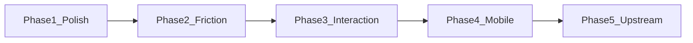

# ApEditor UX enhancements by phase

> Draft roadmap for ApEditor (v0.4.9). Ordered from smallest/easiest UX wins to harder product upgrades. Drawn from documented gaps in `README.md`, `SECURITY.md`, user docs under `docs/`, and one UX redesign note in `docs/REFACTORING.md`.

ApEditor is a local-first AI markdown editor MVP. Engineering splits in `docs/REFACTORING.md` are out of scope here except where they unblock UX.

---

## Phase 1 — Quick polish (smallest / easiest)

Low risk, mostly UI copy, clamps, and clarity. No new architecture.

| Enhancement | Why it helps | Source |
|---|---|---|
| Fix doc drift (font size lives in **Format**, not toolbar −/+) | Users follow outdated help | `docs/workspace.md` vs `docs/writing.md` |
| Clearer empty / gated states (Predict off for Google AI Mode; `@` needs ≥2 docs; OCR ok without key but Markdown rewrite needs one) | Avoid “why is this disabled?” | `docs/troubleshooting.md`, `docs/import.md` |
| Soften ⌘Z surprise (toast / hint that undo is **comment-ops only**) | Typing undo feels broken | `docs/troubleshooting.md` |
| Import size / page caps with a friendly error | Stop tab freezes on huge PDFs | `SECURITY.md` |
| Mentions chip-layout hook (today a no-op) | Less overlap / jump when chips wrap | `src/components/mentions/MentionInput.tsx` (~line 630) |

---

## Phase 2 — Reduce daily friction (easy–medium)

Same product surface; fewer failed Apply / Send moments and less privacy anxiety.

| Enhancement | Why it helps | Source |
|---|---|---|
| Chat: “send selection only” + clearer delimiters | Less accidental full-doc leakage; faster turns | `SECURITY.md` |
| Soft secret redaction before send (API keys / tokens in draft) | Safer BYO-key workflow | `SECURITY.md` |
| Better Apply failures: explain mismatch, jump to anchor, one-click Force-apply path | Exact-substring Apply is the #1 edit friction | `docs/proposed-edits.md`, troubleshooting |
| Outdated-comment cleanup (batch dismiss / re-select) | Comment badges go stale after heavy edits | `docs/comments.md` |
| Export / download Markdown (and maybe JSON backup) | No cloud recovery if `localStorage` is wiped | `docs/privacy.md`, `docs/troubleshooting.md` |
| Session-only API key option (or “forget key on close”) | Shared-browser hygiene without a proxy | `SECURITY.md`, `docs/privacy.md` |

---

## Phase 3 — Interaction redesign (medium)

Visible UX changes; still within the current textarea + panel model.

| Enhancement | Why it helps | Source |
|---|---|---|
| Mentions: single 2-pane picker (docs left, sections right) instead of 2-stage Doc → Section | Fewer popover hops; REFACTORING Option B | `docs/REFACTORING.md` §4 Option B |
| Toolbar density pass on narrow widths (build on v0.4.9 Format dropdown) | Less wrap/clutter on laptops and tablets | `RELEASE_NOTES.md` v0.4.9 |
| Keyboard / shortcut map in Help + conflict hints (⌘B sidebar vs bold) | Discoverability | `docs/keyboard-shortcuts.md`, `docs/workspace.md` |
| Accessibility pass (resize handles, overlays, screen-reader labels for comment layer) | Keyboard / AT users currently underserved | Inferred from comment overlay / drag-resize patterns |
| Google AI Mode paste UX (larger clipboard target, clearer truncated-URL warning) | Keyless path still feels manual | `src/utils/googleAiMode.ts`, chat docs |

---

## Phase 4 — Mobile-first layout (harder)

App “works” on narrow viewports (overlays, bottom sheets) but is explicitly desktop-first.

| Enhancement | Why it helps | Source |
|---|---|---|
| Dedicated mobile layout (editor-first; chat/comments as full-screen sheets) | Primary UX gap called out in README | `README.md` intentionally-not list |
| Touch-friendly comment composer / tray (resize already hidden on mobile) | Soft keyboard + small hit targets | `src/components/CommentPopover.tsx`, App narrow breakpoints |
| Settings / import popovers sized for phone (build on existing clamps) | Historical off-screen popovers | Release notes v0.3.4, SettingsModal clamps |

---

## Phase 5 — Major product upgrades (hardest)

Copy-from-upstream path in README; large UX + architecture shifts. Tackle one at a time.

| Enhancement | UX payoff | Source |
|---|---|---|
| **Lexical** (or equivalent) rich-text editor | Inline formatting, better selection/comments, real undo | `README.md` |
| Token counting / cost tracking UI | Trust and cost awareness while chatting | `README.md` |
| Embeddings / semantic search across docs | Find related passages without `@` hunting | `README.md` |
| Sync (Google Drive / GitHub) or Electron | Multi-device / offline desktop | `README.md` |
| AI agents with tools | Stronger edit workflows beyond proposed-edit fences | `README.md` |
| i18n | Non-English UI | `README.md` |
| Hardened key storage (passphrase Web Crypto or local proxy) | Real secret hygiene | `SECURITY.md` |

---

## What this roadmap deliberately skips

- `docs/REFACTORING.md` Editor/store/api splits — **developer** readability, not end-user UX (do before Lexical if you expect heavy feature work).
- Tests / CI (`docs/ARCHITECTURE.md` §10) — quality gates, not UX features.
- Provider allowlist / host CSP headers — security ops with little interactive UX.

---

## Suggested first implementation slice

If you want the highest UX return for the least change: **Phase 1 + Export Markdown + Apply-failure clarity + import size caps**. That package stays inside the current textarea architecture and directly addresses pain already documented for users.
